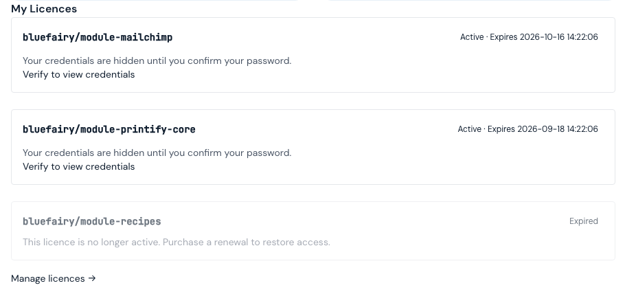
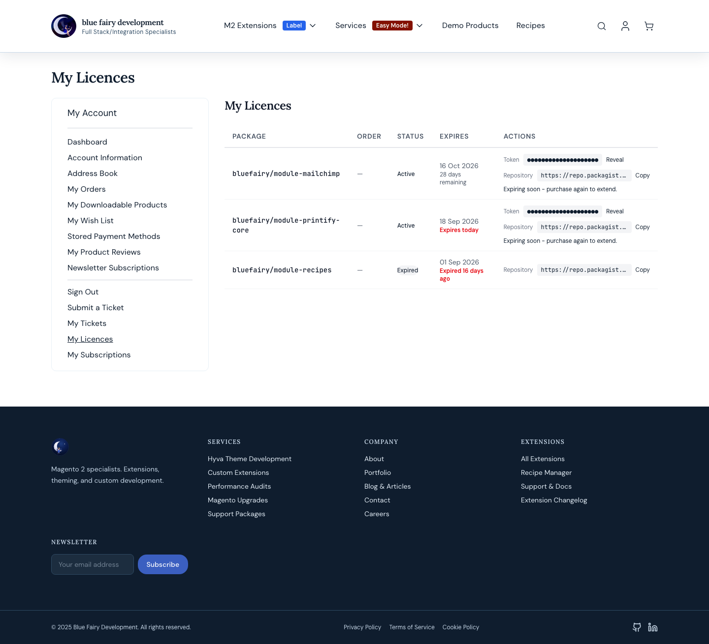
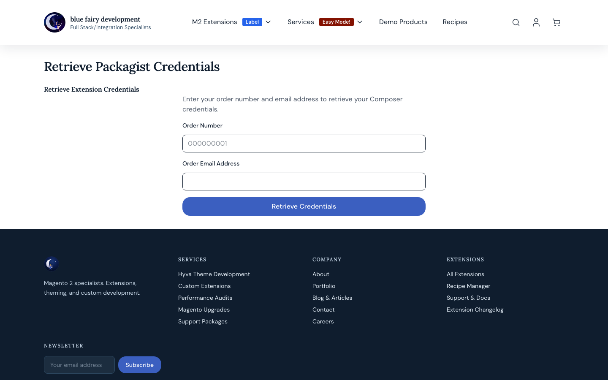
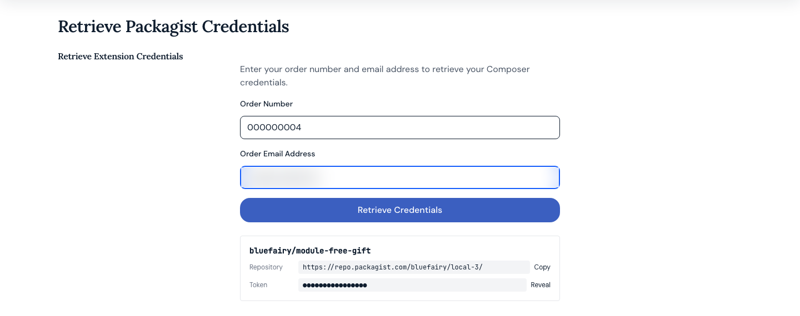

# BlueFairy_PackagistProvisionerHyva — Feature Walkthrough

The Hyvä-native front end for `BlueFairy_PackagistProvisioner`. The base package
provisions the licences and ships templates for Luma and every other theme; this
package replaces the customer-facing surfaces with Hyvä ones (Alpine.js, Tailwind)
and adds two that only exist here: the dashboard block and the order-page block.
Every image below was captured on the 1.2.0 walkthrough against fixture data on a
test store; `docs/images/REVIEWED.md` records what is in each frame and what was
redacted.

---

## 1. My Licences on the account dashboard

Below the address panel on **My Account**, every licence the customer holds, with
its status and expiry. Credentials are hidden until the customer re-enters their
password once per session (the **step-up**, §4); until then each ACTIVE licence
offers *Verify to view credentials*.

After the step-up the same block shows the repository URL with Copy and the token
masked with Reveal and Copy, plus the download count. Expired and revoked licences
are dimmed; a failed one names the store's support address (§6). A *Manage
licences* link leads to the full page.

---

## 2. The My Licences page

**My Account → My Licences** (`/customer/account/licences`), also behind the step-up:

| Column | What it shows |
|---|---|
| Package | The Composer package name |
| Order | The order number the licence came from |
| Status | Active / Pending / Expired / Revoked / Failed, as a badge |
| Expires | The date, with days remaining, *Expires today*, or *Expired N days ago* |
| Actions | The token, masked, with Reveal and Copy; the repository URL with Copy; *Expiring soon - purchase again to extend.* on an ACTIVE licence inside 60 days |

A renewal is a second purchase of the product; there is no renew control. The two
Active licences in the frame are inside 60 days and carry the notice; the Expired
one does not.

---

## 3. The guest credential lookup

`/bluefairy/packagist/guestlookup`, for a customer who checked out as a guest. The
Hyvä form posts as JSON and renders the result in place:

The result shows the order's package, its repository URL with Copy, and the token
masked with Reveal. A PENDING licence says its credentials are being prepared; any
other state (Failed, Expired, Revoked) names the store's support address. Five
attempts per address per hour, and an order placed from a customer account is
refused here - that customer signs in.

---

## 4. Step-up verification

Before a token is shown on the dashboard, the licences page or the order page, the
customer re-enters their password on **Verify Your Identity**. The verified state
is held in the customer session for 15 minutes. The base package's own Luma pages
use the same gate; this package's templates replace the page's layout, not the rule.

---

## 5. Credentials on the order page

**My Account → My Orders → View Order** carries a block for the licences provisioned
from that order: the package, and after the step-up the token with Reveal and Copy.
A PENDING licence says its credentials are being prepared; a FAILED one names the
order number and the store's support address. This surface exists only with this
package installed.

---

## 6. Whose support address

Every "contact support" sentence in this package names the **store's** Customer
Support address (Stores → Configuration → General → Store Email Addresses) - not
Blue Fairy's - so a merchant running the provisioner for their own packages sends
their customers to themselves.

---

## 7. Your theme's CSS

The templates use Tailwind utility classes and register with Hyvä's build
(`view/frontend/tailwind/module.css`). Run `hyva:config:generate` and rebuild your
theme's CSS after installing (README, step 4), or the pages render with only the
classes your theme already uses.
